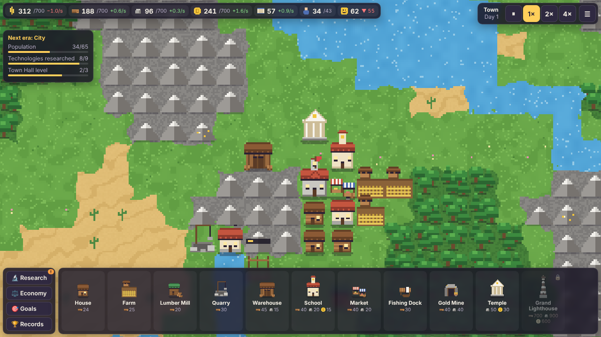

# Tiny Empires: a browser island civilisation builder in TypeScript and Phaser 3

Tiny Empires is a single-player city-builder that runs entirely in the browser. You land on a procedurally generated island with six settlers and a wooden Town Hall. You then grow it through five eras (Hamlet, Village, Town, City, Empire) by placing farms, mills, quarries, houses, markets and schools, researching technologies and handling random events. The game ends when you complete the Grand Lighthouse, and you can keep playing afterwards. There is no server, no account and no downloaded art or audio: the island, the buildings, the icons, the music and the sound effects are all generated by code when the page loads.

The interesting part is the architecture. The simulation is a pure, deterministic function `tick(state, world)`. "Deterministic" means the same starting state always produces exactly the same next state, because all randomness comes from a seeded generator stored inside the state. Rendering (Phaser) and the interface (plain HTML/CSS) never change game rules. They only read the state and send player actions through one controller. This is the same split that lockstep strategy games and replay systems rely on. A save file only needs the world seed plus the mutable state, because the island itself can be regenerated byte-for-byte from the seed.

🔗 **Play:** [open the game](TODO_LIVE_URL)

## Quick start

| Step | Command | Result |
|---|---|---|
| Install | `npm install` | Installs Phaser, Vite, TypeScript and Vitest into `node_modules/` |
| Play locally | `npm run dev` | Dev server at `http://localhost:5173` with hot reload |
| Type check | `npm run typecheck` | `tsc --noEmit`, no output on success |
| Unit tests | `npm test` | 62 tests in 7 files |
| Production build | `npm run build` | Type check, then bundle into `dist/` |
| Preview the build | `npm run preview` | Serves `dist/` at `http://localhost:4173` |
| Browser smoke test (optional) | `npm run qa:smoke` | Needs Python Playwright and a running preview; see [Test procedure](#test-procedure) |

Node 20 or newer is required. Nothing is installed globally.

## How to play

| Goal | How |
|---|---|
| Feed people | Farms on grass or desert (+40% next to a river); Fishing Docks on beaches after **Fishing** |
| Get wood and stone | Lumber Mills next to forest, Quarries next to mountains — each adjacent tile adds output |
| Grow | Houses add housing; people arrive while there is free housing, stored food and happiness ≥ 35 |
| Employ | Production buildings need workers; the "workforce" percentage scales all of them together |
| Research | Schools make knowledge; spend it in the Research panel (**R**) |
| Advance | Meet the era goals shown top-left (population, technologies, Town Hall level) |
| Win | Research **Engineering** in the City era and build the Grand Lighthouse on the coast |

Controls: drag, WASD or the arrow keys to pan; mouse wheel, pinch, or **Q**/**E** to zoom. Pick a building card, then click the map (right-click or **Esc** stops placing). Click a tile or building for details, upgrades and demolition. **Space** pauses, **1**/**2**/**3** set the speed, **R**/**T**/**G** open Research/Economy/Goals, **U** upgrades and **Del** demolishes the selected building. Hovering (or long-pressing on touch) any resource shows exactly where it comes from and where it goes. An interactive tutorial runs on the first game and can be replayed from Settings.

## How it works

| Component | Job | Gets input from | Sends output to |
|---|---|---|---|
| `core/world.ts` | Generates the island from a seed: elevation and moisture noise, biome percentiles, beaches, rivers, gold veins, start tile | Seed string, map size | `World` object (typed arrays) |
| `core/simulation.ts` | One tick: construction, economy, population, research, modifiers, eras, events, achievements | `GameState`, `World` | Mutated `GameState`, list of `GameMessage`s |
| `core/economy.ts` | Pure calculation of production, consumption, housing, jobs, storage and the happiness target | `GameState`, `World` | `EconomyReport` |
| `core/buildingSystem.ts`, `research.ts`, `trade.ts`, `events.ts` | Rule checks and actions (place, upgrade, demolish, research, trade, resolve event) | Player intent | `CheckResult { ok, reason }` and a mutated state |
| `core/save.ts` | Serialise, validate and migrate saves; slot storage | `GameState`, a key-value store | JSON string |
| `config/*.ts` | All tuning data: buildings, technologies, eras, events, achievements, balance constants | — | Read by `core/` |
| `game/GameController.ts` | Owns the state, runs fixed-step ticks from frame time, applies actions, emits events | Frame delta, UI and renderer calls | Typed event bus (`tick`, `changed`, `toast`, `float`, `action`…) |
| `render/` | Phaser scene: terrain texture, building sprites, camera, ghosts, overlays, day/night, effects | Controller state and bus | Pixels; tile clicks back to the controller |
| `ui/` | HTML/CSS interface: resource bar, build bar, panels, modals, tutorial, keyboard | Controller state and bus | Player actions to the controller |
| `audio/AudioEngine.ts` | Web Audio synthesiser: generative music and sound effects | Bus events via `ui/UI.ts` | Speakers |

**Simulation ↔ controller.** The controller turns variable frame time into whole ticks. It adds `delta × speed` to an accumulator and runs `tick()` once per 1000 ms collected, capped at 8 ticks per frame so a slow frame cannot cause a spiral. One tick is one game second at 1× speed. The core never reads the clock, so the same rules run unchanged in Vitest without a browser.

**Controller ↔ UI and renderer.** These use a small typed publish/subscribe emitter (`game/Emitter.ts`). The UI only redraws when it has received `changed`. Open panels rebuild their DOM only when a signature of the values they display changes. The reason for this is in [Known issues](#known-issues-and-limitations): rebuilding every tick swallowed button clicks.

**Rules ↔ data.** Buildings, technologies, eras, events and achievements are declarative tables in `config/`. Adding a technology or an event choice means adding an entry, not new code paths. Events hold their effects as small functions, because choices such as "fund the scholar" have conditional outcomes that a flat table cannot express.

**World ↔ save.** The world is never saved. `generateWorld(seed, size)` is re-run on load, and a test checks that the regenerated terrain is identical. This keeps saves to a few kilobytes and means a save cannot be edited to contain impossible terrain.

## States and modes

| Era | Requirements to enter | Unlocks |
|---|---|---|
| 1. Hamlet | — | Tier 1 research, basic buildings |
| 2. Village | 15 population, 2 technologies, 8 buildings | Tier 2 research, Town Hall Lv2 |
| 3. Town | 35 population, 5 technologies, Town Hall Lv2 | Tier 3 research, Town Hall Lv3 |
| 4. City | 65 population, 9 technologies, Town Hall Lv3 | Tier 4 research, Grand Lighthouse |
| 5. Empire | Grand Lighthouse completed | Victory screen; play continues |

| Building state | Meaning |
|---|---|
| Under construction | `construction > 0` and `upgradeTo = 0`: drawn as scaffolding, produces nothing |
| Active | `construction = 0`: works at its current level |
| Upgrading | `construction > 0` and `upgradeTo > 0`: keeps working at the old level until finished |

| Simulation mode | Behaviour |
|---|---|
| Speeds | Pause, 1×, 2×, 4× |
| Pending event | World frozen until the player chooses; keys 1–3 pick a choice |
| Title screen | Last autosave (or a fresh island) runs paused behind the menu |

## Data format

Saves are JSON in `localStorage` under `tinyempires.save.<slot>`. The slots are `auto`, `slot1`, `slot2` and `slot3`. The same JSON can be exported and imported as text from the Save and Load menus. Settings, achievements and lifetime statistics live separately under `tinyempires.meta`, so they survive starting a new island.

| Field | Type | Notes |
|---|---|---|
| `version` | number | Save format version (currently 1); newer-than-supported saves are rejected |
| `savedAt` | number | Unix ms |
| `state.seed`, `state.size` | string, number | Regenerates the world |
| `state.tick` | number | Game seconds elapsed |
| `state.resources` | `{food, wood, stone, gold, knowledge}` | Floats |
| `state.population`, `popProgress`, `happiness`, `taxRate` | numbers | `popProgress` is the fractional growth accumulator |
| `state.buildings[]` | `{id, type, x, y, level, construction, constructionTotal, upgradeTo}` | Validated on load: type exists, position on map, level in range |
| `state.researched[]`, `state.research` | ids, `{id, remaining, total}` or null | Unknown tech ids are rejected |
| `state.modifiers[]` | `{kind, value, remaining, label}` | Temporary event effects |
| `state.pendingEvent` | `{id, data}` or null | `data` holds numbers rolled when the event fired |
| `state.rng` | number | Mulberry32 state; makes events reproducible |
| `state.stats`, `achievements`, `victory` | objects | Missing fields in older saves are filled with defaults |

## Design files

| File | What it is |
|---|---|
| [`src/config/buildings.ts`](src/config/buildings.ts) | Every building, level, cost, worker count, output, upkeep and placement rule |
| [`src/config/techs.ts`](src/config/techs.ts) | 15 technologies in 4 tiers with prerequisites and effects |
| [`src/config/eras.ts`](src/config/eras.ts) | Era requirements and rewards |
| [`src/config/events.ts`](src/config/events.ts) | 13 events with 2–3 choices each |
| [`src/config/achievements.ts`](src/config/achievements.ts) | 19 achievements |
| [`src/config/balance.ts`](src/config/balance.ts) | Global constants: starting stock, food per person, taxes, happiness, growth, trade |
| [`src/render/sprites.ts`](src/render/sprites.ts) | Procedural pixel art for buildings, scaffolding, trees, peaks and UI icons |
| [`src/render/terrainRenderer.ts`](src/render/terrainRenderer.ts) | Per-pixel island painter with jittered biome borders |
| [`tests/helpers/bot.ts`](tests/helpers/bot.ts) | Scripted greedy player used for balance tests |
| [`scripts/smoke_test.py`](scripts/smoke_test.py) | Headless-browser test across five viewport sizes |
| [`CHANGELOG.md`](CHANGELOG.md) | Development changelog |
| [`THIRD_PARTY_NOTICES.md`](THIRD_PARTY_NOTICES.md) | Licences of dependencies; statement that all assets are original |

## Dependencies

| Package | Version | Role | Shipped to players |
|---|---|---|---|
| Phaser | 3.90.0 (pinned) | WebGL/Canvas rendering, input, tweens | Yes (~1.2 MB, ~330 kB gzipped, separate cached chunk) |
| Vite | ^7.1 | Dev server, bundler | No |
| TypeScript | ~5.9 | Type checking (`strict`, no unused locals) | No |
| Vitest | ^5.1 | Unit tests | No |
| Playwright for Python | any recent | Optional browser smoke test | No |

Vitest was moved from 3.x to 5.x at the start because `npm audit` flagged advisories in the 3.x dependency tree. `npm audit` reports 0 vulnerabilities with the versions above.

Comparable production approaches: the fixed-step, seed-deterministic simulation is the model used by lockstep RTS engines and by roguelikes that regenerate maps from seeds. The data-table configuration is how most commercial strategy games keep designers out of engine code.

## Configuration and deployment

| Setting | Where | Value | Why |
|---|---|---|---|
| Base path | `vite.config.ts` | `base: './'` | Relative asset URLs work from a domain root (Cloudflare) and from a sub-path (`user.github.io/repo/`) without changes |
| Phaser chunk | `vite.config.ts` | `manualChunks: { phaser }` | Game updates do not invalidate the large engine file in browser caches |
| Offline cache | `public/sw.js` | Network-first for HTML, cache-first for assets | Works offline after the first visit; registered only in production builds |
| PWA manifest | `public/manifest.webmanifest` | Fullscreen, any orientation | Installable to a phone home screen |
| Cache headers | `public/_headers` | Immutable `/assets/*`, no-cache HTML and SW | Cloudflare Pages reads this file; GitHub Pages ignores it harmlessly |

**GitHub Pages.** `.github/workflows/deploy.yml` runs `npm ci`, `npm test` and `npm run build`, then publishes `dist/` on every push to `main`. To use it, push the repository to GitHub, then set Settings → Pages → Source to **GitHub Actions**.

**Cloudflare Pages.** Connect the repository and set the build command to `npm run build`, the output directory to `dist` and the environment variable `NODE_VERSION=22`. No other configuration is needed.

**Any static host.** Upload the contents of `dist/`.

### Things that must NOT be done

- ⚠️ Do not call `Math.random()` or read the clock anywhere under `src/core/` or in event effects. Use `nextRandom(state)`. Breaking this breaks determinism, and with it replayable events and the save/continue test.
- ⚠️ Do not change the shape of `GameState` without bumping `SAVE_VERSION` and adding a step to `migrate()` in `core/save.ts`. Otherwise existing players' saves will fail validation.
- ⚠️ Do not change `core/world.ts` or `core/noise.ts` casually. Any change alters every island, so existing saves would load onto different terrain, with buildings possibly sitting in the sea.
- ⚠️ Do not open `dist/index.html` from the file system. ES modules and the service worker need an HTTP server (`npm run preview`).
- ⚠️ Do not commit `node_modules/` or `dist/` (both are in `.gitignore`). If `node_modules` was ever copied from another operating system, delete it and run `npm install` again, because Vite's native binaries differ per platform.

## Test procedure

1. Run `npm install`, then `npm test`. Expect **62 passed** across `world`, `economy`, `buildings`, `research`, `events`, `save` and `balance`. The balance file runs a scripted player through six seeds and takes a few seconds.
2. Run `npm run build`. Expect `tsc` to print nothing and Vite to print three assets: `index.html`, a ~120 kB game chunk and a ~1.2 MB Phaser chunk. **Vite's chunk-size warning is disabled on purpose for the Phaser chunk.**
3. Run `npm run preview` and open `http://localhost:4173`. The title screen appears over a paused island. Choose **New island → Found settlement**. The tutorial appears at once, and the first task (build a farm) is available within seconds.
4. Place a farm next to the Town Hall. The card highlights, valid tiles turn green and a ghost follows the pointer. On placement you should see scaffolding with a yellow progress bar, then "Farm built!" with a pop-in animation.
5. Hover the food counter. The tooltip lists the Town Hall, the farm and "Population eats", and its net matches the rate shown in the bar.
6. Leave it running at 4× for a few minutes. An event dialog appears and freezes time until a choice is made. Toasts warn if food is about to run out.
7. Open **Menu → Save game → Slot 1**, reload the page and use **Load game → Slot 1**. The island, buildings and resources return exactly as saved. **Keep this in mind: closing the tab also autosaves, so "Continue" on the title screen loads the most recent autosave rather than Slot 1.**
8. Optional automated browser check: install the Python Playwright package (`pip install playwright`, then `playwright install chromium`, or pass `--chrome` with your own Chrome). With `npm run preview` running, run `npm run qa:smoke`. It drives the real UI at 1440×900, 1280×720, 768×1024, 390×844 and 844×390. It places a farm by clicking the canvas and opens the research panel. It also round-trips a save inside the browser and fails on any console error. Screenshots go to `qa-screens/`, which is git-ignored.

## Results and observations

Observed during development (headless Chrome 153 with the SwiftShader software renderer on Linux, plus Node 22):

| Check | Result |
|---|---|
| `npm test` | 62/62 passing |
| `tsc --noEmit` (strict) | No errors |
| Production build | Succeeds; game code 120 kB (41 kB gzipped), Phaser 1.2 MB (332 kB gzipped) |
| Smoke test, 5 viewports | No console errors; farm placed via real clicks or taps on every size; in-browser save/load identical |
| Audio | AudioContext reaches `running` after a user gesture; music scheduler advancing; all 11 effects play without errors (not listened to: headless) |
| New 80×80 island (generate + paint terrain) | ~0.5 s in headless Chrome |
| Frame rate | 18 fps under the SwiftShader software renderer, which says little about real hardware; real-GPU figure: TODO_MEASURE_FPS_ON_REAL_HARDWARE |
| Safari / Firefox / real phones | Not tested: TODO_TEST_SAFARI_FIREFOX_REAL_DEVICES |

Scripted-player runs on 64×64 islands (game minutes at 1×; the player can run at up to 4×):

| Seed | Village | Town | City | Lighthouse (win) | Peak population | Events handled |
|---|---|---|---|---|---|---|
| amber-1234 | 9.4 | 15.4 | 26.9 | 35.4 | 170 | 17 |
| tide-42 | 3.8 | 8.1 | 14.6 | 26.3 | 147 | 12 |
| coral-7 | 5.9 | 17.3 | 21.4 | 29.5 | 143 | 13 |
| fjord-99 | 8.5 | 12.8 | 24.6 | 30.1 | 119 | 13 |
| opal-5150 | 5.9 | 19.1 | 22.6 | 33.0 | 143 | 16 |
| sage-2024 | 9.4 | 14.8 | 22.4 | 34.6 | 140 | 16 |

The bot acts every 3 seconds with perfect information, so a new human player should take longer. How long real players take is unmeasured: TODO_PLAYTEST_HUMAN_COMPLETION_TIME.

## Derived figures

These are calculated from `config/` on paper, not measured.

**How many people one farmer feeds.** A level 1 farm makes 1.0 food/s with 2 workers, and each person eats 0.13 food/s:

$$\frac{1.0 / 2}{0.13} \approx 3.8\ \text{people per farmer}$$

At level 3 (2.7 food/s, 4 workers) this rises to $\frac{2.7/4}{0.13} \approx 5.2$, and a river bank multiplies both by 1.4. The result is that food never needs more than about a quarter of the workforce, which leaves real choices about where the rest go.

**Time pressure at the start.** The Town Hall makes 0.35 food/s and six settlers eat $6 \times 0.13 = 0.78$ food/s, a net loss of 0.43 food/s:

$$t_{empty} = \frac{90}{0.43} \approx 209\ \text{s} \approx 3.5\ \text{minutes}$$

This is why the tutorial asks for a farm first. It is urgent enough to matter but leaves time to read.

**Population growth.** With free housing and food in store, growth per second at happiness $h$ and population $P$ is

$$r = \left(0.05 + 0.0035\,(h - 35)\right) \cdot \frac{60}{60 + P}$$

At the start ($h = 62$, $P = 6$) that is about 0.13/s, one new settler every 7.6 s. At $P = 60$ it halves to about 0.07/s. The damping term stops a large city from snowballing.

**Trading cannot be exploited.** Selling a lot of 10 pays $\lfloor 10\,v \cdot 0.55\,(1+b) \rfloor$ gold and buying costs $\lceil 10\,v \cdot 1.6\,(1 - b/2) \rceil$, where $v$ is the base value and $b$ the trade bonus. The largest possible bonus is $b = 0.25$ (markets) $+ 0.10$ (Currency) $+ 0.15$ (Navigation) $= 0.5$. For wood ($v = 1.1$), that gives a sell price of 9 and a buy price of 14, so a buy-then-sell loop loses at least 5 gold. The code also forces buy ≥ sell + 1 as a backstop, and a test checks it.

**Storage needed to win.** The Lighthouse costs 900 stone, which is more than the Town Hall Lv3 cap of 800. At least one warehouse (+200) is required. This is intentional: it makes storage a planned investment rather than an afterthought.

## Known issues and limitations

- **AI-written code.** The whole codebase (design, balance numbers, art and audio code, tests) was written by an AI assistant (Claude) in a single autonomous session from a written brief. The brief chose the stack and scope. The user has not yet reviewed the code line by line or played a full game: TODO_OWNER_REVIEW.
- **Balance is bot-tuned, not human-tuned.** All numbers were tuned against a greedy scripted player that reacts every 3 seconds. Late game, its stockpiles balloon (thousands of wood and gold), so the last era is probably too easy for anyone who expands aggressively. A human playtest is the next step.
- **Milestone commits are coarse.** Milestones 1–3 share one commit because the systems were developed together and the intermediate states were never separately buildable. Milestones 4 and 5 have their own commits.
- **Browser coverage.** Only Chromium (headless) was exercised. Safari's Web Audio and `backdrop-filter`, Firefox's pointer events and real touch devices are untested.
- **Frame-rate numbers are meaningless so far.** The only figure (18 fps) came from software rendering.
- **Emoji icons in event dialogs** depend on the operating system's emoji font and will look different on Windows, macOS and Android.
- **The territory rule can strand the coast.** The Lighthouse must touch the sea, and territory only grows near buildings. On islands where the start is far inland, the player must "walk" houses toward the shore. The bot needed a special rule for this, so a human might be confused too. The placement tooltip explains the reason, but nothing hints at it in advance.
- **Population can exceed housing temporarily.** Accepting all migrants in the "Settlers Arrive" event can overcrowd the settlement on purpose. Overcrowding costs happiness but is not otherwise blocked. This is a design choice, not a bug.
- **Autosave overwrites a single slot.** Starting a new island and playing for 30 seconds replaces the previous autosave. Manual slots are the only protection.
- **Broke during development: clicks swallowed by live panels.** The Research and Economy panels first rebuilt their DOM on every tick. At 4× speed, a click whose mouse-down and mouse-up straddled a rebuild never reached the new button. The clue was that buttons worked when paused but felt "sticky" when running. The fix was to rebuild only when a signature of the panel's visible values changes.
- **Broke during development: build-bar cards hundreds of pixels tall.** The CSS rule sizing the building image (`.bcard img`) also matched the small cost icons inside the same card, so each 11 px icon was stretched to 32×52 px. The first screenshot made it obvious. The fix was the child selector `.bcard > img`.
- **Broke during development: the tutorial covered the map on landscape phones.** At 844×390 the tutorial box sat over the only tile the automated test could tap, so placement failed. The fix was a `max-height: 520px` layout that moves the tutorial to the top right and compacts the bars. The test now also checks with `elementFromPoint` that the target tile is really the canvas.
- **Broke during development: one biome swallowed whole islands.** The first world generator used fixed moisture thresholds, so some seeds came out almost all forest and others almost all desert. Biomes are now assigned by percentile of the island's own land (bottom 17% moisture → desert, top 34% → forest, top 14% elevation → mountain).
- **Harmless but worth knowing.** `ctrl.update()` clamps each frame to 250 ms, so calling `update(1000)` from the console advances only a quarter of a tick. This confused a test script during development. It is correct for real frames, where it prevents a long-hidden tab from jumping minutes ahead.

## Things I learned

Keeping the simulation pure paid for itself many times over. Every rule could be tested in milliseconds without a browser. The balance bot could play six full games in about three seconds, and "load a save and continue" could be proven identical by running two copies side by side and comparing them.

Balancing an economy game is mostly about who the bottleneck is at each moment. Early on it is food and wood. In the middle it is knowledge, then stone and storage. The numbers were changed until the bot's resource log showed each one becoming the constraint in turn, rather than until any single number "looked right".

Screenshots find interface bugs that type checks cannot. Most of the UI fixes in this project came from looking at headless-browser screenshots at five sizes, not from reading code.

## Future improvements

- Run human playtests and retune the late game (likely: higher City-era costs, building upkeep scaling with era, or diminishing tax returns).
- Measure the frame rate on a real GPU and a mid-range phone, and profile the 80×80 terrain paint on mobile.
- Add a minimap with click-to-jump, and a hint arrow toward the coast once Engineering is researched.
- Replace emoji event icons with pixel-art icons from `sprites.ts` for a consistent look on every platform.
- Store autosaves in a small rolling history (last three) instead of a single slot.
- Add colour-blind-safe outlines for the valid and invalid placement tints, and full keyboard navigation of the map.
- Add a seeded daily challenge (same island for everyone, compare completion time), which the deterministic core already supports.

## License

MIT — see [LICENSE](LICENSE). Phaser is MIT-licensed; all art and audio are original and generated at runtime. See [THIRD_PARTY_NOTICES.md](THIRD_PARTY_NOTICES.md).
